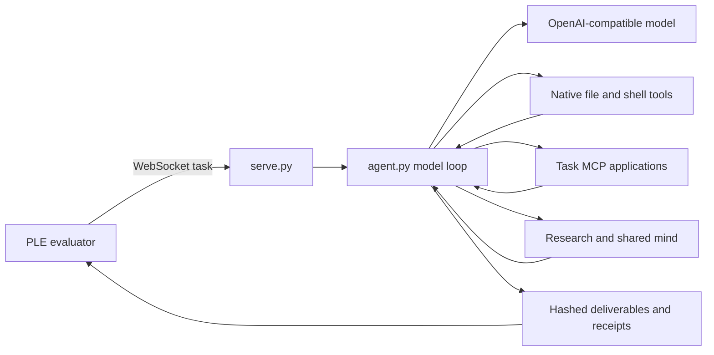

# PLE Harness

PLE Harness is a model-agnostic agent runtime for
[Physical-Engineering's Last Exam](https://github.com/google-research/ple). It connects any
OpenAI-compatible model to a bounded tool loop, the PLE WebSocket protocol,
task-provided MCP applications, local research retrieval, and an auditable
shared memory.

The project is also an evaluation system. It records model calls, tool use,
deliverables, token usage, failures, and memory writes so that a result can be
checked instead of inferred from a final answer.

> **Start here:** [docs/HANDOFF.md](docs/HANDOFF.md) is the current source of
> truth for repository state and next work. Everything that runs belongs under
> this repository.

The [documentation index](docs/README.md) lists canonical designs, evidence,
historical snapshots, and the [next additive tasks](docs/NEXT-TASKS-BEYOND-HANDOFF.md).

For Claude project setup, paste the [project instructions](docs/CLAUDE-PROJECT-INSTRUCTIONS-PASTE.md)
and consult the [expanded runbook](docs/CLAUDE-PROJECT-INSTRUCTIONS.md),
which define the math, research-ingestion, Frontier Loop, attention/FEP,
verification, and storage contracts.

## Current status

The core PLE server, model loop, native tools, MCP forwarding, local research
retrieval, context carving, and SurrealDB atom/trajectory paths are implemented.
Live multi-turn probes have completed on Mistral Large 4 and Nemotron Ultra
550B. The Step 5 PLE probe is retained as an excluded failure.

The full cross-harness engineering campaign is not complete. DeepSeek Harness
still needs its live adapter, and the recall-first forward policy, active
inference controller, local forward-state continuation, and sparse attention
experiments remain preregistered work.

| Area | State | Evidence |
|---|---|---|
| PLE protocol and tool loop | Implemented | `tests/protocol_smoke.py`, live probe trajectories |
| Generic versus PLE behavior probe | Partially complete | [probe results](ablations/probes/results.json) |
| Prompt carving | Live replay evidence | [attention-economics report](reports/attention-economics/README.md) |
| Nested Surreal atoms and trajectories | Implemented with readback receipts | `frontier/surreal.py`, probe receipts |
| Tensor-page identity and admission | Component-tested | `frontier/kv_contract.py`, `frontier/kv_assembly.py` |
| Production local forward adapter | Open | [forward design](frontier/TPPE-LOCAL-FORWARD-DESIGN.md) |
| Recall-first and FEP policy | Designed and preregistered | [implementation handoff](docs/recall-first-forward/HANDOFF.md) |
| Full cross-harness campaign | Incomplete | [campaign results](ablations/api/results.json) |

## What the measurements show

### Generic harness versus PLE probe


This graph covers one 27-step tool task per model and harness. Mistral and
Nemotron completed under both harnesses. PLE used more prompt tokens in those
two comparisons. Step 5 PLE did not close and is shown only as consumed work.
The probe establishes tool-loop behavior, deliverable production, and
harness-side atom mint/readback. It does not establish better engineering
quality or lower cost.

### Nemotron context-carving replay


In a separate live NVIDIA replay of the same 15 recorded steps, carving on
every call reduced total prompt tokens from 435,634 to 129,781 and uncached
prompt tokens from 185,746 to 121,013. Prefix-stable carving preserved more of
the provider cache but sent more tokens than carving every call.


Elapsed time is included for completeness. Each arm ran once, so the timing is
descriptive and cannot establish a throughput improvement. The replay does not
measure recall-first inference, sparse tensor attention, or physical energy.

## How a task runs



`serve.py` accepts one PLE session. `agent.py` builds the model request,
executes native tool calls, forwards MCP calls, records usage, and controls the
step and time budgets. `taskbridge.py` contains the evaluator protocol and MCP
client inherited from the PLE kit.

The harness refuses a `finish` call submitted alongside another tool call. The
model must first receive and inspect the tool result. This prevents it from
claiming output that has not returned yet.

## Tools available to the model

- `bash`, `read_file`, `write_file`, and `finish` are available on every task.
- `engineering_verify` checks a bounded inline manifest for sourced 3D boxes,
  routes, clearances, ordered states, and declared junction flow balance. It
  returns deterministic findings and a manifest hash; it does not certify CAD
  solids or physics. See the [tool design](docs/ENGINEERING-VERIFIER-DESIGN.md).
  The same gate runs from a terminal with
  `.venv/bin/python -m engineering_verify path/to/manifest.json` (exit 0 pass,
  1 findings, 2 invalid input), so product and systems-engineering pipelines
  can use it without a model.
- `mcp_list`, `mcp_schema`, and `mcp_call` expose task applications such as
  spreadsheets, documents, PDF tools, FreeCAD, mail, and code execution. These
  are meta-tools: the model requests a schema when needed instead of receiving
  hundreds of definitions in every prompt.
- `rag_search` and `rag_open` query the local Qdrant Edge research library when
  it is mounted.
- Mind tools search, open, mint, and connect verified SurrealDB atoms and
  trajectories when shared memory is enabled.
- Frontier agents can load the `ple-artifacts` skill and call `artifact_render`
  to write `.txt`, `.md`, `.pdf`, `.docx`, SVG mind maps or DAGs, and interactive
  3D/4D HTML graphs. This is available through the same frontier entry point
  that Zed launches. The [documentation standard](docs/DOCUMENTATION_STANDARDS.md)
  defines evidence and accessibility requirements.
  The [engineering modeling guide](docs/PLE-ENGINEERING-MODELING.md) maps the
  PLE kit tools, drawing-to-IFC workflow, 4D cooling-system state, verification
  loops, and current implementation gaps.

All model seats use the same text and trajectory contract. Optional local
tensor continuation is selected by runtime capability, never by a model name
or a fixed layer count.

## Quick start

Requirements: macOS or Linux, Python 3.12, `uv`, and the sibling PLE kit.

```bash
cd /Users/stewartbarteau/Desktop/PhyEngLastExam/harness
uv venv --python 3.12 .venv
uv pip install --python .venv/bin/python -r requirements.txt pytest
```

Run the offline suite and wire-level protocol smoke:

```bash
.venv/bin/python -m pytest tests -q
.venv/bin/python tests/protocol_smoke.py
```

For live NVIDIA validation, export `NVIDIA_API_KEY` or place it in the ignored
`.env` file. The launchers can also read the existing macOS Keychain entry
without printing it.

```bash
scripts/run_local.sh check
scripts/run_local.sh dev roof-deck-design,wind-diaphragm-shear
```

Running `scripts/run_local.sh dev` without task names runs the complete dev
set. Results land in `../runs/ple-harness-<time>/`. Local rubric scores are
diagnostic because the official leaderboard judge may differ.

Without a provider key, run the protocol against the mock endpoint:

```bash
.venv/bin/python tests/mock_openai.py 8099 &
cd ../ple
uv run python -m kit check ../harness \
  --env-file <file-with-MODEL_API_KEY=test> \
  --model-base-url http://localhost:8099/v1
```

## Model configuration

The evaluator normally supplies `MODEL_NAME`, `MODEL_BASE_URL`, and
`MODEL_API_KEY`. The local launcher accepts `MODEL=<provider-model-id>`.
Competition submissions must follow the model restrictions in the sibling PLE
kit.

| Variable | Default | Purpose |
|---|---:|---|
| `MAX_OUTPUT_TOKENS` | `16000` | Maximum output tokens for one model call |
| `COMPACT_AT_TOKENS` | `90000` | Estimated context size that triggers old tool-output carving |
| `MAX_STEPS` | `400` | Maximum model calls in one task |
| `RESERVE_SECONDS` | `240` | Time reserved for producing and checking deliverables |
| `FRONTIER_MIND` | enabled | Set `off` for the preregistered no-mind arm |
| `FRONTIER_N3` | `sqlite` | Short-term session-memory backend |
| `FRONTIER_EDGE_SHARD` | local vault path | Qdrant Edge research shard |

Local profiles live in `~/.config/frontier/profiles.json`. A profile may
declare a `local_runtime` factory. The runtime reports its tokenizer, chat
template, position contract, layer shapes, K/V layout, and recurrent state.
The harness does not infer these values from the model name.

## Cross-harness campaign

The campaign compares the independent generic baseline, DeepSeek Harness, and
PLE while holding models, tasks, tools, budgets, and judges fixed. Its governing
documents are [ablations/DESIGN.md](ablations/DESIGN.md) and
[ablations/PREREGISTRATION.md](ablations/PREREGISTRATION.md).

Only complete, judge-passing cells enter the final table. Failed, partial, and
excluded attempts remain visible in [ablations/FAILURES.md](ablations/FAILURES.md).
`ablations/receipts.py` requires live response IDs, tool execution, completed
judges, deliverable hashes, telemetry, and validated memory receipts before a
row is admitted.

The generic and Harness2 paths reach the real evaluator through an authenticated
loopback relay. They do not receive copied task workspaces or simulated tool
results. Pinned upstream sources remain unmodified and are excluded from this
repository's Git history.

```bash
MODEL_SEAT=mistral scripts/run_generic_baseline.sh check
MODEL_SEAT=mistral scripts/run_generic_baseline.sh run wind-diaphragm-shear

scripts/run_ablation.sh harness2 check
scripts/run_ablation.sh harness2 run wind-diaphragm-shear
```

The lightweight behavior probe bypasses the engineering tasks:

```bash
scripts/run_multiturn_probe.sh generic mistral
scripts/run_multiturn_probe.sh ple mistral
scripts/summarize_multiturn_probes.py
```

It measures loop and tool behavior only. Harness-side atom minting is an
observation, not evidence that the model learned from or used an atom.

## Memory and research

PLE uses three distinct forms of state:

| State | Store | Meaning |
|---|---|---|
| Recent conversation | SQLite N3 | Short-term turns and archived tool output |
| Knowledge atoms and trajectories | Nested SurrealDB | Shared, verified semantic memory |
| Native tensor pages | Nested SurrealDB through the Rust bridge | Exact local-runtime state bound to model and prefix identity |

SQLite does not hold tensors. Tensor pages remain inside the existing nested
SurrealDB authority and are accessed through `native-kv-bridge`. The bridge and
Python admission layer verify workspace, model weights, tokenizer, adapter,
position contract, causal prefix, shapes, fragments, and payload hashes.

These contracts have synthetic and storage-level tests. No production local
runtime adapter has passed trained-model restart, logit, token, latency, and
memory qualification. TPPE can relocate positional phases, but it does not make
deeper K/V computed under a different causal prefix exact.

The local Qdrant Edge shard provides model-independent BM25 research retrieval.
Its copy, verification, and restoration protocol is documented in
[docs/RESEARCH_LIBRARY_EDGE_DESIGN.md](docs/RESEARCH_LIBRARY_EDGE_DESIGN.md).
The shard is host-side infrastructure and is not packaged with a submission.

## Recall-first forward policy

The next implementation asks a bounded scout to decide what verified knowledge
is worth recalling before the main prompt is prefetched. Hosted models use a
scout call followed by a main call. A local runtime may branch from a clean
task-prefix state only after complete-state isolation and parity against a
fresh prefill are proven.

Read the packet in this order:

1. [Design](docs/recall-first-forward/DESIGN.md)
2. [Preregistration](docs/recall-first-forward/PREREGISTRATION.md)
3. [Active inference and FEP audit](docs/recall-first-forward/FEP-INTEGRATION.md)
4. [Implementation handoff](docs/recall-first-forward/HANDOFF.md)

FEP means the Free Energy Principle in this packet. It requires an executable,
calibrated policy with explicit observations, beliefs, actions, preferences,
uncertainty, and receipts. FEP terminology does not itself create a sparse
attention kernel or prove lower computational or physical energy.

## Frontier improvement loop

`frontier/` can run research, audit, design, preregistration, implementation,
review, and measurement stages against a selected folder. The state machine
records attempts and prevents repeated failed work signatures. Two cycles with
nothing retained force a redesign rather than an endless retry loop.

| Path | Responsibility |
|---|---|
| `frontier/pipeline.py` | Staged workflow, approvals, work orders, review, and redesign |
| `frontier/core.py` | Results, gates, snapshots, scope, sandbox, and budgets |
| `frontier/n3.py` | Short-term SQLite memory and Qdrant Edge access |
| `frontier/surreal.py` | Shared mind, atom, trajectory, and tensor authority |
| `frontier/local_chat.py` | Optional local-runtime dispatch |
| `frontier/checkpoints.py` | Exact-prefix checkpoint discovery and publication |
| `frontier/kv_contract.py` | Model-neutral native-state identity contract |

The detailed scope and unqualified claims are maintained in
[frontier/SCOPE.md](frontier/SCOPE.md).

## Safety and fair play

- File and shell tools are restricted to the active workspace and temporary
  directories when the macOS sandbox is enabled.
- The harness refuses task tests, graders, and artifact directories. It contains
  no task-specific branching.
- Web fetches reject local addresses.
- Secrets stay in environment variables, ignored files, or the macOS Keychain.
- Native state fails closed on missing, corrupt, foreign, or incomplete identity.
- Failed experiments remain visible; incomplete runs are not promoted.

## Repository map

| Path | Purpose |
|---|---|
| `serve.py` | Production PLE WebSocket entry point |
| `agent.py` | Model, tool, retry, carving, usage, and time-budget loop |
| `taskbridge.py` | PLE protocol and task MCP transport |
| `submission.yaml` | Production submission entry |
| `frontier/` | Memory, research, local runtime, and improvement pipeline |
| `native-kv-bridge/` | Rust boundary for nested tensor-page operations |
| `runtime/` | Rust runtime, schemas, contracts, and component tests |
| `ablations/` | Cross-harness designs, adapters, receipts, probes, and results |
| `reports/` | Evidence reports and reproducible figures |
| `tests/` | Offline unit, integration, adversarial, and protocol tests |

## Apple Silicon container notes

The full PLE kit uses Colima for task and verifier containers. A practical VM
allocation is 8 CPUs and 24 GB of memory. The egress sidecar and evaluator may
require `linux/amd64`; on Apple Silicon use the VZ backend with Rosetta.

```bash
softwareupdate --install-rosetta --agree-to-license
colima start --cpu 8 --memory 24 --vm-type vz --vz-rosetta
```

Use `scripts/run_ablation.sh <harness> run-local <task>` for live campaign
cells on this Mac. This keeps the harness on the host while the smaller task
and verifier environments use Colima.

## Next steps and intended outcome

The next work stays inside PLE and follows the frozen handoff:

1. Implement `RecallPlanV1`, the bounded scout, and fail-closed SurrealDB
   admission without changing the preregistered limits.
2. Add phase-level accounting for scout inference, retrieval, branch or
   re-prefill, main prefill, decode, tools, tokens, cache reads, and wall time.
3. Run the paired A0/A1 policy comparison. Keep failures and negative results.
4. Add clean-prefix local branching and qualify it against fresh prefill on at
   least two independent model architectures before calling it model-agnostic.
5. Treat sparse tensor-page attention as a separate runtime arm with explicit
   key-read, quality, selection-cost, and end-to-end measurements.
6. Finish the API and local cross-harness campaigns, including local mind-off
   versus mind-on tasks that test whether recalled knowledge causally changes
   an action and enables a verified completion.
7. Build the attention-economics paper only from admitted receipts and opened
   primary sources.

The goal is a harness that helps different models complete longer and harder
engineering tasks without uncontrolled context growth or retry loops. Success
means more judge-passing completions, bounded and explainable resource use,
reliable tool behavior, and a causal record of when shared knowledge changed a
model's plan. It also means knowing when an optimization does not help: token
reduction, runtime speed, task quality, and physical energy remain separate
claims until each one is measured.

## Documentation

- [Current operator handoff](docs/HANDOFF.md)
- [Frontier scope and evidence boundaries](frontier/SCOPE.md)
- [Cross-harness design](ablations/DESIGN.md)
- [Cross-harness preregistration](ablations/PREREGISTRATION.md)
- [Recall-first implementation handoff](docs/recall-first-forward/HANDOFF.md)
- [Receipt-backed graph notes](reports/attention-economics/README.md)
- [Documentation standards](docs/DOCUMENTATION_STANDARDS.md)
- [Artifact rendering design](docs/ARTIFACTS-DESIGN.md)

The README describes the project. The handoff controls the next implementation
step whenever the two differ.
